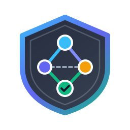
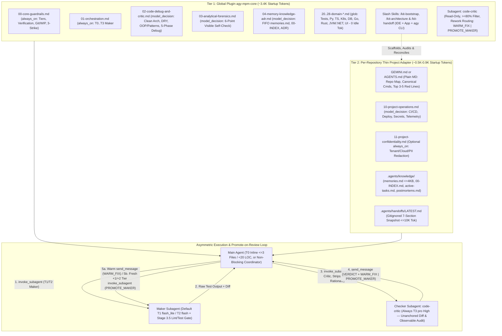

# `gemini-mpm` (`agy-mpm-core`)

**Portable Multi-Agent Engineering, Context-Isolated Code Review & Zero-Overhead Rule Kit for Google Antigravity (IDE, Antigravity 2.0 App & `agy` CLI)**

**[🇬🇧 English](README.md) | [🇷🇺 Русский](README.ru.md)**

`v1.5.0` · **MIT License** · **0 Lines of Wrapper Code** · **`~3.8K` Startup Tokens (`<20%` Budget)** · **EN + RU Editions**

---

`gemini-mpm` (`agy-mpm-kit`) packages battle-tested multi-agent engineering discipline into **100% native Google Antigravity primitives**: Caveman-compressed `rules/` (with 3-mode orchestration across `T0` inline, `teamwork`/`swarm` exact model+effort pinning, and coarse `invoke_subagent` fallback, live `Promote-on-Review` dynamic escalation, knowledge-first subagent boot, and zero-idle-cost polyglot `glob` packs `20..28`), cross-surface `/kit-bootstrap`, `/kit-architecture` & `/kit-handoff` `skills/`, and a context-isolated adversarial `code-critic` subagent (`agents/code-critic.md`). Install it once globally as a local plugin, scaffold thin per-repository adapters in ~90 seconds, and keep full architectural cleanliness, cost efficiency, and verification rigor across every repository on your machine without bloating your context window.

### 30-Second Quickstart

```bash
git clone https://github.com/asabadyr/gemini-mpm.git ~/Projects/gemini-mpm
cd ~/Projects/gemini-mpm

# Install globally as a live-toggleable Antigravity plugin (English or Russian edition)
./install.sh --lang en      # Default: English Core (~35-40% lower token footprint)
# ./install.sh --lang ru    # Alternative: Native Russian Core & Russian project templates
```

Then open any repository in **Google Antigravity** (IDE, App, or `agy` CLI) and run:

```text
/kit-bootstrap --migrate    # Losslessly migrate existing GEMINI.md / CLAUDE.md / .cursorrules
/kit-bootstrap --full       # Scaffold a production / multi-service / K8s workspace adapter
/kit-bootstrap --lite       # Scaffold a lightweight library / CLI adapter
/kit-architecture audit     # Scan for God files (>400/600 LOC), DRY duplicates & pattern gaps
```

---

## Table of Contents

1. [Motivation: Why Monolithic Instruction Files Break at Scale](#1-motivation-why-monolithic-instruction-files-break-at-scale)
2. [Origins & Inspiration (`bobmatnyc/claude-mpm`) — Why `0` Wrapper Code](#2-origins--inspiration-bobmatnycclaude-mpm--why-0-wrapper-code)
3. [Eleven Core Innovations Inside `agy-mpm-kit`](#3-eleven-core-innovations-inside-agy-mpm-kit)
4. [Architecture Diagram & Token Budget](#4-architecture-diagram--token-budget)
5. [Native Bilingual Support (`EN` Root vs `RU` `./ru/` Edition)](#5-native-bilingual-support-en-root-vs-ru-ru-edition)
6. [Four Installation & Multi-Project Topologies (`realpath` Guide)](#6-four-installation--multi-project-topologies-realpath-guide)
7. [Day-to-Day Workflows](#7-day-to-day-workflows)
8. [Repository Structure Map (`/` EN & `/ru` RU)](#8-repository-structure-map--en--ru-ru)
9. [Customization & Extending the Kit](#9-customization--extending-the-kit)
10. [Credits, Attribution & MIT License](#10-credits-attribution--mit-license)

---

## 1. Motivation: Why Monolithic Instruction Files Break at Scale

Most AI-assisted engineering setups start with a single `GEMINI.md` or `CLAUDE.md` file and steadily accrete rules after every bug. Across real production multi-service workspaces, monolithic instruction files fail in six predictable ways:

| Failure Mode | What Goes Wrong in Practice |
|---|---|
| **1. Context-Window Pollution** | Stuffing universal coding rules, Python/TS/K8s style guides, CI/CD runbooks, and database gotchas into a single `15–50 KB` always-on file burns **`4,000–13,000+` tokens on every turn**—even for a 10-second status question. |
| **2. Middle-Context Attention Dilution** | Long prose paragraphs and verbose `<example>` blocks bury critical `🔴` red lines in the middle of the system prompt, causing models to skip verification steps or drop items from multi-part user prompts. |
| **3. Self-Review Confirmation Bias** | When a single agent reviews its own code—or when a reviewer subagent reads the author's persuasive commit rationale—anchoring bias causes it to rationalize edge-case bugs instead of falsifying behavior. |
| **4. Tautological, Flaky & Silently-Skipped Tests** | Agents routinely write existence-only assertions (`assert res is not None`), use `sleep(0.5)` in async tests, mock the System Under Test, or treat `"0 tests collected"` / `"N skipped"` as a passing test suite. |
| **5. Cross-Session Amnesia & Stale Handoffs** | Hard-won architectural constraints vanish between sessions, while unverified session handoff notes go stale and contradict live `git status`, risking accidental destruction of uncommitted developer WIP. |
| **6. Copy-Paste Drift & Double-Loading** | Copying `.agents/rules/` across 5–20 repositories guarantees instant version drift—and in Antigravity, copying global rules into a workspace **injects both files simultaneously**, silently doubling token usage. |

---

## 2. Origins & Inspiration (`bobmatnyc/claude-mpm`) — Why `0` Wrapper Code

`agy-mpm-kit` is deeply inspired by Bob Matsuoka's pioneering open-source [**`bobmatnyc/claude-mpm`**](https://github.com/bobmatnyc/claude-mpm) framework, along with [**`claude-mpm-agents`**](https://github.com/bobmatnyc/claude-mpm-agents) and [**`claude-mpm-skills`**](https://github.com/bobmatnyc/claude-mpm-skills).

### Why `claude-mpm` Required a Python CLI Wrapper — And Why Antigravity Does Not

In Claude Code, `claude-mpm` had to grow into a ~250-file Click/FastAPI/Socket.IO Python wrapper around the CLI binary because:
1. Claude Code plugins initialized *after* system prompt assembly and could not inject top-level orchestration rules pre-turn.
2. An upstream model-routing bug ignored subagent frontmatter `model:` fields, requiring Python `PreToolUse` hooks to route model tiers.
3. Subagents were stateless one-shot calls (`~95K`-token cold reload on every lint/test rework), and monitoring required an external Socket.IO + Svelte web server.

**Google Antigravity solves 100% of that infrastructure natively.** As a result, `agy-mpm-kit` ships **`0` lines of Python CLI, daemon, Socket.IO, or hook-wrapper code**:

| Capability | `claude-mpm` (`v6.5+`) | `agy-mpm-kit` on Google Antigravity |
|---|---|---|
| **Pre-Turn Rule Loading & Progressive Disclosure** | Python CLI wrapper assembling system prompts + `build-agent.py` | Native pre-turn `GEMINI.md` / `.agents/rules/*.md` / Plugin `rules/` with `always_on`, `model_decision`, `glob`, and `manual` triggers + `@[label](path)` includes |
| **Dynamic Subagent Model & Sandbox Routing** | Python `PreToolUse` hook (`model_tier_hook.py`) | Native `invoke_subagent(Model="flash_lite"\|"flash"\|"pro"\|"inherit", Workspace="inherit"\|"branch"\|"share")` |
| **Rework Continuation & Live Subagent UI** | Stateless re-dispatch + external Socket.IO/Svelte monitor | Stateful subagents woken reactively via **`send_message(Recipient=conversationId)`** (zero cold reload!) + native Subagents/Tasks UI |
| **Strategic Planning, Autonomous & Learning Flows** | Custom CLI commands & hook scripts | Native `/plan`, `/grill-me`, `/boost`, `/teamwork`, `/goal`, `/compact`, `/learn` + cross-surface `/kit-bootstrap`, `/kit-architecture` & `/kit-handoff` skills |
| **Real-World Dirty-Tree & Multi-Repo Safety** | Mandates `ONE FILE PER COMMIT`, auto-commits every phase, and assumes root `.git` | **Upgraded**: Protects dirty user WIP, enforces explicit-path `git add <file>`, and checks `<workspace>/.git` for multi-repo non-git umbrellas |

---

## 3. Eleven Core Innovations Inside `agy-mpm-kit`

### 1. Caveman Table-Driven Prompt Compression & HSDF Messaging
Grounded in empirical MPM benchmarks where converting verbose prose rules (`47 KB` / `~12.7K` tokens) into dense decision tables (`10.8 KB` / `~2.7K` tokens) cut system-prompt tokens by **`-77%`**, reduced total session tokens by **`-47%`**, and **improved QA rubric adherence by `+17%` (`3.75/5 -> 4.40/5`)**. Subagent delegations use **HSDF (Hybrid Structured Delegation Format)** (`tier`, `Effort`, `task`, `scope_allowlist`, `contracts`, `observable`, `return`, `context`), keeping prompts compact while never compressing exact file paths, line numbers, tool names, or stack traces.

### 2. Two-Tier Architecture (Universal Core vs Thin Project Adapter)
Separates **Tier 1 (`agy-mpm-core` Global Plugin)**—which is byte-for-byte identical across Python, TypeScript, Go, Rust, JVM/.NET, Frontend UI, and Kubernetes projects—from **Tier 2 (Thin Per-Repo Project Adapter)** generated by `/kit-bootstrap`. Session-start baseline overhead stays at **`~3.8K` tokens** (`<20%` of Antigravity's `20,000`-token `defaultRulesBudget`), while stack-specific `glob` rules (`20..28`) consume **`0` tokens** until matching files are active.

### 3. Context-Isolated Adversarial `code-critic`
`agents/code-critic.md` defines a dedicated Checker subagent restricted to `[read_file, run_command, manage_task, send_message]` (omitting `edit_file` and `write_file` for tool-surface hygiene). When invoked, the orchestrator **strips the Maker's narrative rationale and commit prose**, supplying only requirements, contracts, `git diff`, raw test stdout, and the exact runtime observable. `code-critic` applies a strict **`>=80%` confidence filter**, enforces a strictness-upgraded verdict rule (**any `CRITICAL` or `HIGH` defect => mandatory `BLOCK`**), and runs automatic **OWASP + multi-tenant security audits** whenever diffs touch auth/JWT, crypto/secrets, SQL/NoSQL queries, shell execution, file uploads/paths, deserialization, or tenant boundaries.

### 4. 5-Phase Systematic Debugging + 3-Strike Circuit Breaker
Bans guess-and-patch debugging in `02-code-debug-and-critic.md` by enforcing five sequential gates: **1. Reproduce deterministically -> 2. Isolate (`git bisect` / minimal repro) -> 3. Trace Root Cause backward -> 4. Fix Root Cause (banning symptom-masking `try/catch`, arbitrary sleeps, or blind retries) -> 5. Add Deterministic Regression Test**. If **3 attempts** fail on the same bug, test, or subagent loop, `00-core-guardrails.md` trips the **3-Strike Stop Rule**: stop patching in circles, summarize falsified hypotheses, question the architectural assumption, and escalate options to the user.

### 5. 6-Point Analytical & Data Forensics Visible Self-Check
Whenever an agent produces metrics, cloud cost/utilization reports, database count/rate queries, benchmarks, or log forensics, `03-analytical-forensics.md` mandates an explicit **`Visible Self-Check`** footer auditing: (1) Dimensional & Unit Consistency (`s` vs `ms`, `MiB` vs `GiB`, base64 wire expansion `× 4/3`), (2) Time-Series Aggregation Semantics (weighting bursty gauges by runtime rather than summing window means / `avg_over_time`), (3) Denominator & Population Survival (`deleted: false`), (4) Control Cohort Baseline, (5) Artifact Over Abstraction, and (6) Single-Hypothesis Falsification.

### 6. Test Quality Inspector & 3-Level Contract Pyramid
Combines `00-core-guardrails.md` and `20-domain-tests-and-contracts.md` to eliminate hollow test suites:
- **Silent-Skip & Target-Env Guard**: `"0 tests collected"`, `"N skipped"` on target code, empty stdout, or running outside the repo's real virtual environment/toolchain **fails** verification immediately.
- **Anti-Tautology & Mental Mutation Check**: Bans `assert res is not None` / `toBeDefined()` and requires checking *"if I invert the target `if` branch or shift `<` to `<=`, does at least one test fail?"*
- **Deterministic Async & Clean Prod Boundaries**: Bans fixed wall-clock `sleep()` / `setTimeout()` in favor of bounded condition polling (`waitFor`), bans mocking internal SUT methods, and bans `_for_testing()` methods on production classes.
- **3-Level Contract Pyramid**: Layers (L1) Postcondition & boundary unit tests, (L2) Generator-encoded property-based tests (`hypothesis` / `fast-check`), and (L3) Negative precondition tests.

### 7. Dirty-Tree Git & Non-Git Multi-Repo Umbrella Safety
Built for real developer workspaces with uncommitted WIP and multi-repository parent folders:
- **WIP & Secret Protection**: Bans `git checkout <file>`, `git restore <file>`, `git reset --hard`, `git clean`, and wildcard staging (`git add .`, `git add -A`, `git commit -a`). Enforces explicit-path staging (`git add path/a path/b`), pre/post `git status -s` + `git show --stat HEAD` audits, and guilty-until-verified secret stops (`sk-`, `ghp_`, `AKIA`, `npm_`, `xox`, `AIza`, PEM).
- **`<workspace>/.git` Precondition**: Verifies `<workspace>/.git` exists *before* passing `Workspace="share"` or `"branch"` to `invoke_subagent`. In non-git multi-repo umbrella directories (where `.git` lives inside child `<subrepo>/.git` folders), agents automatically use `Workspace="inherit"` with disjoint sub-repo ownership or explicit `git -C <subrepo> worktree add`—preventing immediate worktree crashes and fake root `.git/info/exclude` files.

### 8. Bounded 5-Section `FIFO` `memories.md` (`<=4 KB`) + Chronological Authority Matrix
`04-memory-knowledge-adr.md` automatically captures persistent user directives (`"remember"`, `"always"`, `"never"`, `"going forward"`) as single-line ISO-dated facts (`- [YYYY-MM-DD] <fact>`) across 5 bounded sections: `CRITICAL` (max `20`, never auto-evicted), `Environment` (`15`), `Decisions` (`20`), `Patterns` (`20`), and `Gotchas` (`15`), using deterministic **FIFO (oldest-first) eviction** within a **`<=4 KB`** cap. Multi-paragraph lessons graduate to `postmortems.md` under a **Chronological Authority Matrix (`00-INDEX.md`)** where newer verified timestamps + live code win on conflict, paired with a **3-Gate Nygard ADR filter** and `/learn` integration.

### 9. Redacted 7-Section Session Handoffs (`LATEST.md`)
`/kit-handoff pause` is advisory and fail-open (never killing in-flight background subagents). It scans and redacts secrets to `<REDACTED:VAR_NAME>` before writing a compact, gitignored 7-section snapshot (`.agents/handoffs/LATEST.md`, `<=10K` tokens). On `/kit-handoff resume`, the agent **mandatory-reconciles `LATEST.md` against live `git status -s` and `git log --oneline -10`** so live repository state always overrides stale handoff prose.

### 10. Clean Architecture, Anti-God-File, DRY, OOP/Design Patterns & Polyglot Packs (`20..28` + `/kit-architecture`)
Prevents AI-generated spaghetti, copy-paste proliferation, and monolithic files while distinguishing **Production Mainline** code (default) from **Throwaway Prototypes / `scratch/`** (`<200–300` LOC single-file allowed, banned from mainline imports):
- **Hard Size & Complexity Caps (`02` + `code-critic`)**: Plans modular splits at **`400` LOC** (hard cap **`600` LOC** per file), **`<=300` LOC** per class (`<=200` LOC UI components), **`<=30/50` LOC** per function, cyclomatic complexity **`<=10`**, and nesting depth **`<=3`** via guard clauses.
- **Search-Before-Create & DRY Consolidation**: Mandates searching existing helpers first, **One Implementation Per Feature** (deleting superseded dead code), and extracting reusable functions/collaborators whenever **`2+` same-domain blocks exceed `>80%` similarity** or **`>=30` LOC** (while guarding against wrong-DRY cross-domain coupling).
- **Problem-First OOP, SOLID & Design Patterns**: Enforces Composition over Inheritance (`depth <=2`), Constructor Dependency Injection, and concrete smell-to-pattern mappings (`3+` repeated `if/else`/`switch` chains -> **Strategy / Handler Registry**, persistence leakage -> **Repository**, external 3rd-party APIs -> **Adapter / Anti-Corruption Layer**, complex assembly -> **Factory / Builder**, cyclic calls -> **Domain Events**, slow upstream cascades -> **Circuit Breaker**).
- **Zero-Idle-Cost Polyglot Best Practices**: Ships `9` `trigger: glob` domain packs (`20..28`: Tests/Contracts, Python, TypeScript/Node.js, K8s/Infra, SQL/MongoDB, Go, Rust, Java/Kotlin/C# `.NET`, and React/Next/Vue/Svelte Frontend UI) plus the progressive-disclosure `/kit-architecture` skill covering **12 language ecosystems** (`+ PHP, Ruby, Elixir/OTP, Swift/Dart, C/C++`) and safe `<=200`-LOC chunked God-file refactoring.

### 11. 3-Mode Orchestration (`T0` Inline, `teamwork`/`swarm` Exact Model+Effort Pinning & Live `Promote-on-Review`)
Solves the fundamental limitation of standard `invoke_subagent` (which is restricted to 4 coarse tier aliases and exposes no API-level thinking effort control) by establishing three distinct execution modes across `01-orchestration.md`, `02-code-debug-and-critic.md`, and `agents/code-critic.md`:
- **Mode 1 — Direct Inline (`T0`)**: Zero subagent overhead for `<=3` file reads, quick Q&A, and trivial `<20` LOC single-step edits in the Main Agent.
- **Mode 2 — Exact Model + Effort Multi-Agent Flow (`teamwork` & Native `swarm`)**: Required whenever a project (`GEMINI.md`/`AGENTS.md`) defines exact role profiles (e.g. Implementer, Researcher, Critical Reviewer):
  * **Built-in `teamwork` Flow (`/teamwork`)**: Enforces the **Prompt-Top Matrix Rule (`🔴`)** by prepending the workspace's Role -> Model + Effort Matrix verbatim at the prompt top (`teamwork` subagents cannot see parent conversation history). Supports **`[skip-interview]`** for rapid execution when specs are concrete (`>=90%`), single-iteration workers with unanchored promotion (`iterN+1` at `+1/+2` tiers on Stage 3.5 stall or reviewer `BLOCK`), and strict `.gitignore` tracking for `.agents/teamwork/`.
  * **Native `swarm` Flow**: Leverages native swarm catalog discovery (`swarm{action:"models"}`), pins exact model+effort per worker (`swarm{action:"add"}`), and performs **live in-place promotion** (`swarm{action:"model"}`) on waiting workers without losing conversation context.
- **Mode 3 — Coarse `invoke_subagent` Fallback (`flash_lite | flash | pro | inherit`)**: Follows the `T1..T3` pre-dispatch rubric with Maker `1–2` tiers below max and Checker at top tier (`pro` + `High`). Spawns a fresh higher-tier subagent on `Promote-on-Review`.
- **Knowledge-First Subagent Boot (`🔴`)**: Eliminates wasteful cold surveys by requiring parent orchestrators to pass `knowledge_refs:` (`GEMINI.md`, `00-INDEX.md`, `memories.md`, and topic guides) in every prompt/dispatch/brief. Subagents read these in Step 0 before scanning files, skipping blind discovery waves when architectural context already exists.
- **Cache-First Gate (`🟡`)**: When `>=75%` of requested analytics or report data exists in local cached files, agents slice/render cached data directly rather than spawning heavy top-tier subagents to recompute from scratch.

---

## 4. Architecture Diagram & Token Budget



### Complete File & Token Budget Breakdown

Every rule file sits well under `<35%` of Antigravity's `24,000`-byte per-file hard cap, and aggregate session-start context consumes **`<20%` of Antigravity's `20,000`-token `defaultRulesBudget`**:

| Layer | File | Trigger | Disk Size (EN) | Startup Tokens | On-Demand Tokens |
|---|---|---|---|---|---|
| **Tier 1 Core** | `rules/00-core-guardrails.md` | `always_on` | `4,402 B` (`4.4 KB`) | `~1,100` | *(Already loaded)* |
| **Tier 1 Core** | `rules/01-orchestration.md` | `always_on` | `12,755 B` (`12.8 KB`) | `~3,180` | *(Already loaded)* |
| **Tier 1 Core** | `rules/02-code-debug-and-critic.md` | `model_decision` | `8,245 B` (`8.2 KB`) | `~45` *(desc)* | `~2,060` |
| **Tier 1 Core** | `rules/03-analytical-forensics.md` | `model_decision` | `2,542 B` (`2.5 KB`) | `~35` *(desc)* | `~635` |
| **Tier 1 Core** | `rules/04-memory-knowledge-adr.md` | `model_decision` | `3,344 B` (`3.3 KB`) | `~35` *(desc)* | `~835` |
| **Tier 1 Domain** | `rules/20-domain-tests-and-contracts.md` | `glob` *(test files)* | `3,082 B` (`3.1 KB`) | **`0`** | `~770` |
| **Tier 1 Domain** | `rules/21-domain-python.md` | `glob` (`*.py`, `pyproject.toml`) | `2,978 B` (`3.0 KB`) | **`0`** | `~745` |
| **Tier 1 Domain** | `rules/22-domain-typescript-node.md` | `glob` (`*.ts`, `*.tsx`, `*.js`) | `2,890 B` (`2.9 KB`) | **`0`** | `~725` |
| **Tier 1 Domain** | `rules/23-domain-k8s-and-infra.md` | `glob` (`*.yaml`, `Dockerfile`, `*.tf`, `*.sh`) | `2,235 B` (`2.2 KB`) | **`0`** | `~560` |
| **Tier 1 Domain** | `rules/24-domain-sql-mongo-migrations.md` | `glob` (`migrations/**`, `*.sql`, `*schema*`) | `2,186 B` (`2.2 KB`) | **`0`** | `~545` |
| **Tier 1 Domain** | `rules/25-domain-go.md` | `glob` (`*.go`, `go.mod`, `go.sum`) | `3,286 B` (`3.3 KB`) | **`0`** | `~820` |
| **Tier 1 Domain** | `rules/26-domain-rust.md` | `glob` (`*.rs`, `Cargo.toml`) | `3,080 B` (`3.1 KB`) | **`0`** | `~770` |
| **Tier 1 Domain** | `rules/27-domain-jvm-and-dotnet.md` | `glob` (`*.java`, `*.kt`, `*.cs`, `pom.xml`, `*.csproj`) | `3,170 B` (`3.2 KB`) | **`0`** | `~795` |
| **Tier 1 Domain** | `rules/28-domain-frontend-ui.md` | `glob` (`*.tsx`, `*.jsx`, `*.vue`, `*.svelte`, `*.css`) | `3,395 B` (`3.4 KB`) | **`0`** | `~850` |
| **Tier 1 Skills** | `skills/kit-architecture/SKILL.md` (+ 3 guides) | Slash `/kit-architecture` | `4,287 B` (`4.3 KB`) | `~40` *(desc)* | `~1,070` *(+ refs)* |
| **Tier 1 Skills** | `skills/kit-bootstrap/SKILL.md` (+ 8 templates) | Slash `/kit-bootstrap` | `12,607 B` (`12.6 KB`) | `~45` *(desc)* | `~3,150` |
| **Tier 1 Skills** | `skills/kit-handoff/SKILL.md` (+ 1 template) | Slash `/kit-handoff` | `4,238 B` (`4.2 KB`) | `~35` *(desc)* | `~1,060` |
| **Tier 1 Agent** | `agents/code-critic.md` | Subagent `code-critic` | `7,260 B` (`7.3 KB`) | `~40` *(desc)* | `~1,815` *(isolated)* |
| **Tier 1 Extras** | `extras/manual-rules-fallback/90..92` | `manual` (`@90...`, `@91...`, `@92...`) | `12,878 B` *(3 files)* | **`0`** | *IDE/App fallback* |
| **Tier 2 Adapter** | `<repo>/GEMINI.md` *(or `AGENTS.md`)* | Plain MD (`always_on`) | `~1.8–2.5 KB` | `~450–625` | *(Already loaded)* |
| **Tier 2 Adapter** | `.agents/rules/10-project-operations.md` | `model_decision` *(`--full`)* | `~2.0–5.0 KB` | `~35` *(desc)* | `~500–1,250` |
| **Tier 2 Adapter** | `.agents/rules/11-project-confidentiality.md` | `always_on` *(optional)* | `~1.1–1.5 KB` | `~275–375` *(opt)* | *(Already loaded)* |
| **Tier 2 Lore** | `.agents/knowledge/*` & `handoffs/LATEST.md` | Read on demand | `<=4 KB` (`memories.md`) | **`0`** | Read selectively |
| **TOTAL** | **Baseline Session Start (`Core + Adapter`)** | — | — | **`~3,845` tokens** (`~4.1K` w/ `11-*`) | **`19.2%` of `20K` budget** |

---

## 5. Native Bilingual Support (`EN` Root vs `RU` `./ru/` Edition)

`agy-mpm-kit` ships two complete, self-contained plugin trees inside the same repository:
- **English Edition (`/` repository root)** — English rules (`00..04`, `20..28`), English skills (`/kit-bootstrap`, `/kit-architecture`, `/kit-handoff`), English `code-critic`, and English project adapter templates.
- **Russian Edition (`./ru/` directory)** — 100% native Russian translations of every rule, skill, `code-critic` prompt, fallback playbook, and `/kit-bootstrap` + `/kit-handoff` template (`GEMINI.md`, `memories.md`, `00-INDEX.md`, `LATEST.md`).

Because `~/.gemini/config/plugins/agy-mpm-core` is a **single symlink** pointing to *either* `<repo>` (`EN`) *or* `<repo>/ru` (`RU`), **both editions never load at the same time**—guaranteeing zero rule duplication.

| Aspect | `EN` Edition (`--lang en`, Default) | `RU` Edition (`--lang ru`, `./ru/`) |
|---|---|---|
| **Session-Start Token Cost** | **`~3.8K` tokens** (~35–40% fewer BPE tokens per rule) | **`~5.1K–5.8K` tokens** (Cyrillic BPE tokenization; still `<29%` of `20K` budget) |
| **Chat Response Language** | Agent still answers fluently in **English, Russian, or any language** you prompt in | Agent answers in Russian with Russian audit/self-check headers |
| **Generated Repo Templates (`/kit-bootstrap`)** | Scaffolds `GEMINI.md`, `memories.md`, `00-INDEX.md`, `LATEST.md` in **English** | Scaffolds `GEMINI.md`, `memories.md`, `00-INDEX.md`, `LATEST.md` in **Russian** |
| **Best For** | Maximum context-window efficiency, OSS/international repos, mixed-language coding | Russian-first engineering teams wanting native Russian project docs & memory files |

### One-Command Switching (`install.sh`)

```bash
./install.sh --lang en      # Point ~/.gemini/config/plugins/agy-mpm-core -> <repo>
./install.sh --lang ru      # Point ~/.gemini/config/plugins/agy-mpm-core -> <repo>/ru
./install.sh --status       # Inspect active symlink target, version & edition
./install.sh --uninstall    # Safely remove symlink (refuses if target is a real directory)
```

<details>
<summary><strong>Manual <code>ln -s</code> installation (without <code>install.sh</code>)</strong></summary>

```bash
mkdir -p ~/.gemini/config/plugins
rm -f ~/.gemini/config/plugins/agy-mpm-core

# English edition:
ln -s ~/Projects/gemini-mpm ~/.gemini/config/plugins/agy-mpm-core

# OR Russian edition:
ln -s ~/Projects/gemini-mpm/ru ~/.gemini/config/plugins/agy-mpm-core
```
</details>

---

## 6. Four Installation & Multi-Project Topologies (`realpath` Guide)

> [!CAUTION]
> **Critical Antigravity Invariant: `realpath`-Only Deduplication & Cumulative Rules**
> Antigravity deduplicates rule files **strictly by resolved physical path on disk (`realpath`)**—never by content hash—and Global + Workspace rules are **cumulative**.
> **NEVER run `cp` to copy Universal Core rules (`00..04`, `20..28`) into `<repo>/.agents/rules/` while the global `agy-mpm-core` plugin is enabled!** Two physical files have two distinct `realpath`s and will be injected into your prompt **twice**, doubling token consumption.

Choose the topology that matches each repository's collaboration model:

### Mode A (Recommended Solo / Multi-Project): Global Local Plugin + Thin Repo Adapter
Install `agy-mpm-core` once globally via `./install.sh --lang en` (or `--lang ru`). Inside each project repository, keep **only** the Tier-2 Project Adapter (`GEMINI.md`, optional `10-*`/`11-*`, `.agents/knowledge/`).
- **Live 1-Click Toggle**: Manage via `/plugin` or open `customization://agy-mpm-core` in Antigravity chat (always keyed on the install directory name `agy-mpm-core`; never hand-edit `~/.gemini/config/config.json`).
- **Multi-Repo Subfolder Safe**: Because `agy-mpm-core` is global (`isGlobal: true`), Universal Core stays active even when you open an individual child repo (`<umbrella>/<service>/`) directly—where directory walk-up stops at `<service>/.git`.

### Mode B (Shared Team Repository in Git)
When teammates want the full rule/skill/critic bundle committed directly inside `<team-repo>/.agents/{rules,skills,agents}/` so `git clone` works out of the box without installing a global plugin:
1. Commit the rules, skills, and `code-critic.md` into `<team-repo>/.agents/`.
2. On your machine, **toggle `agy-mpm-core` off in 1 click** via `/plugin` (`customization://agy-mpm-core`) while working in `<team-repo>` *(or symlink `<team-repo>/.agents/rules/{0*,2*}.md` locally to `~/Projects/gemini-mpm/rules/` so `realpath` resolves both paths to the exact same inode and loads each rule once)*.

### Mode C (Personal Stealth Overlay on a Shared Team Repo via `.git/info/exclude`)
When contributing to a company or open-source repo where you do **not** want to commit `GEMINI.md` or `.agents/` into team PRs:
1. Keep global `agy-mpm-core` enabled.
2. Run `/kit-bootstrap` and choose **`Personal overlay on shared repo`**.
3. `/kit-bootstrap` appends `GEMINI.md`, `AGENTS.md`, and `.agents/` to `<repo>/.git/info/exclude` (**strictly when `<repo>/.git` exists as a real Git directory**; in a non-git multi-repo umbrella root, root adapter files already sit outside child `<subrepo>/.git` repositories, so a fake `.git/info/exclude` is never created). Result: **zero footprint in `git status` or pull requests**.

### Mode D (Pure-Rules Zero-Skill Fallback for IDE & App)
If your environment permits `.agents/rules/*.md` only (no `skills/` directory):
1. Copy or symlink `extras/manual-rules-fallback/90-playbook-bootstrap.md`, `91-playbook-handoff.md`, and `92-playbook-architecture.md` (`trigger: manual`, `0` idle tokens) into `.agents/rules/`.
2. Invoke them in **Antigravity IDE** or **Antigravity 2.0 App** chat via `@90-playbook-bootstrap.md`, `@91-playbook-handoff.md`, and `@92-playbook-architecture.md`.
3. *Platform Note*: The **`agy` CLI does not support `@` rule mentions**—use Modes A–C (`skills/`) whenever working in `agy` CLI.

| Topology | Where Tier-1 Core Lives | Where Tier-2 Adapter Lives | Prevents Double-Loading Via | `agy` CLI Support |
|---|---|---|---|---|
| **Mode A: Global Plugin** *(Recommended)* | `~/.gemini/config/plugins/agy-mpm-core` symlink | `<repo>/GEMINI.md` + `.agents/{rules/10-*,knowledge}` | Single physical Core copy | Yes (`/kit-*`) |
| **Mode B: Team Repo in Git** | `<team-repo>/.agents/{rules,skills,agents}` | `<team-repo>/GEMINI.md` + `.agents/{rules/10-*,knowledge}` | Toggle `agy-mpm-core` off in `/plugin` (or `ln -s` same `realpath`) | Yes (`/kit-*`) |
| **Mode C: Stealth Overlay** | `~/.gemini/config/plugins/agy-mpm-core` symlink | Local `<repo>/GEMINI.md` + `.agents/` in `.git/info/exclude` | Single physical Core copy + local Git exclude | Yes (`/kit-*`) |
| **Mode D: Zero-Skill Fallback** | `rules/` + `90..92-playbook-*.md` (`manual`) | `<repo>/GEMINI.md` + `.agents/knowledge/` | Single rule directory | IDE & App only (`@90...`) |

---

## 7. Day-to-Day Workflows

### 7.1 Onboarding a New Repository (`/kit-bootstrap --lite` vs `--full`)

- **`/kit-bootstrap --lite`** *(~90s — small libraries, CLIs, `<5` modules)*:
  Scans stack manifests (`package.json`, `pyproject.toml`, `go.mod`, `Cargo.toml`, etc.) and `git log`, asks **one** confirmation question via `ask_question`, and creates a compact plain-Markdown `GEMINI.md` (`~1.8 KB`), seeded `.agents/knowledge/memories.md`, and `.gitignore` entry for `.agents/handoffs/`.
- **`/kit-bootstrap --full`** *(~90s — production services, monorepos, multi-repo umbrellas, K8s/cloud)*:
  Adds `.agents/rules/10-project-operations.md` (`model_decision` — keeping CI/CD, K8s rollout, namespace, and secret runbooks out of pure coding turns), optional `.agents/rules/11-project-confidentiality.md` (`always_on`), and `.agents/knowledge/{00-INDEX.md, active-tasks.md, postmortems.md}`.
- **Automatic `--migrate` Safety Upgrade**: If `/kit-bootstrap --lite` or `--full` detects any pre-existing agent instruction files in the workspace, it **automatically switches to `--migrate`** so existing project rules are never silently overwritten.

### 7.2 Migrating Existing Repositories Losslessly (`/kit-bootstrap --migrate`)

Consolidates legacy or cross-agent setups into a clean Tier-2 Project Adapter in five verified steps:
1. **Exhaustive Discovery**: Scans `GEMINI.md`, `AGENTS.md` (root & nested), `.agents/rules/*.md`, legacy `.agents/workflows/*.md`, `CLAUDE.md`, `.claude/**`, `.cursorrules`, `.cursor/rules/**`, `.windsurfrules`, `CODEX.md`, `.remember/**`, and agent sections in `CONTRIBUTING.md`.
2. **Lossless Backup Gate**: Copies every discovered file preserving relative paths into `<appDataDir>/brain/<conversation-id>/scratch/rule-migration-backup/` before touching a single workspace byte.
3. **4-Bucket Triage Matrix**:
   - *Bucket 1 (Universal Core Duplicates)* -> **Dropped** (already covered by `00..04` & `20..28`, immediately reclaiming prompt tokens).
   - *Bucket 2 (Behavioral Conflicts)* -> **Surfaced via `ask_question`** (e.g., unsafe auto-commits or skipped tests).
   - *Bucket 3 (Always-On Identity & Red Lines)* -> **Condensed** into plain-Markdown `GEMINI.md` (or shared `AGENTS.md` for multi-tool Claude + Cursor + Antigravity teams).
   - *Bucket 4 (Ops, Subdir Rules, Lore & Workflows)* -> **Structured** into `10-project-operations.md` (`model_decision`), `11-project-confidentiality.md` (`always_on`), optional `12-<subproject>.md` (`trigger: glob`, `globs: "**/<subdir>/**"`), `.agents/knowledge/*`, and converts legacy `.agents/workflows/*.md` into `.agents/skills/<name>/SKILL.md`.
4. **Single `ask_question` Confirmation**: Confirms triage plan, collaboration mode (Mode A / B / C / multi-tool `AGENTS.md`), and confidentiality rule inclusion.
5. **Mandatory `code-critic` Lossless Verification Audit**: Spawns `code-critic` (`Model="pro"`, `Effort: High`) to diff the generated adapter against `scratch/rule-migration-backup/`, blocking completion unless **0 project invariants, canonical commands, regexes, namespace maps, or links were lost**.

### 7.3 Pausing, Resuming & Compounding Knowledge (`/kit-handoff` & `/learn`)

- **`/kit-handoff pause`**: Checks active background tasks/subagents without interrupting them, redacts credentials (`sk-`, `ghp_`, `AKIA`, `npm_`, `xox`, `AIza`, PEM, Bearer tokens), ensures `.agents/handoffs/` is gitignored, and writes `.agents/handoffs/LATEST.md` (`<=10K` tokens). Recommends `/compact` if continuing in a long chat.
- **`/kit-handoff resume`**: Reads `LATEST.md` + `memories.md` and **reconciles them against live `git status -s` and `git log --oneline -10`** (across root `.git` or child `*/*/.git` sub-repos). Live Git state always wins over stale handoff notes.
- **`/kit-handoff postmortem`**: Audits session errors, `code-critic` `BLOCK` verdicts, and 3-strike pivots from session logs, records 1-line `FIFO`-bounded lessons in `memories.md` (+ detailed timelines in `postmortems.md`), and recommends Antigravity's native **`/learn`** command when a lesson warrants a permanent cross-repo rule or skill.

### 7.4 Clean Architecture, Safe God-File Refactoring & Polyglot Best Practices (`/kit-architecture`)

- **`/kit-architecture audit [path]`**: Quantitatively scans files `>400/600` LOC, classes `>300` LOC, functions `>50` LOC, deep nesting `>3`, `>80%` duplicated blocks, concrete I/O coupled inside domain classes, and repeated type-tag switches, separating **Production Mainline** from `scratch/` prototypes.
- **`/kit-architecture refactor <target>`**: Decomposes monolithic `600–5,000+` LOC files in behavior-preserving **`<=200` LOC chunks** with pre/post test gates, **One Implementation Per Feature** dead-code cleanup, and `Added / Removed / Net LOC` reporting.
- **`/kit-architecture patterns [problem]` & `/kit-architecture lang <stack>`**: Consults progressive-disclosure references for problem-first OOP/SOLID pattern selection and idiomatic engineering across **12 language ecosystems** (`Python`, `TypeScript/Node`, `Go`, `Rust`, `Java/Kotlin`, `C#/.NET`, `React/Next/Vue/Svelte`, `PHP`, `Ruby`, `Elixir/OTP`, `Swift/Dart`, `C/C++`).

### 7.5 Synergy with Built-In Antigravity Slash Commands

| Scenario | Recommended Command |
|---|---|
| Align on architecture or ambiguous requirements before coding (`>500` LOC) | `/plan` or `/grill-me` |
| Deep multi-perspective reasoning & rigorous verification on hard problems | `/boost` |
| Coordinated autonomous multi-agent execution across a large project | `/teamwork` or `/goal` |
| Free up context window mid-session (pair with `/kit-handoff pause`) | `/compact` |
| Promote a project discovery into a reusable global skill or rule | `/learn` |

---

## 8. Repository Structure Map (`/` EN & `/ru` RU)

```text
gemini-mpm/
├── plugin.json                                     # EN plugin manifest (agy-mpm-core v1.5.0)
├── install.sh                                      # Safe symlink installer & EN/RU switcher (--lang en|ru, --status, --uninstall)
├── LICENSE                                         # MIT License + claude-mpm conceptual attribution
├── README.md                                       # English flagship documentation
├── README.ru.md                                    # Russian flagship documentation (100% parity)
├── assets/
│   └── logo.svg                                    # 256x256 square plugin icon (~12.5% safe margin)
├── rules/                                          # FLAT 1-level directory (Antigravity scans 1 level deep!)
│   ├── 00-core-guardrails.md                       # always_on: severity tiers, item-by-item, verification, Git/WIP, 3-strike
│   ├── 01-orchestration.md                         # always_on: T0..T3 Maker<Checker routing, Promote-on-Review, Wave 0-2, .git check
│   ├── 02-code-debug-and-critic.md                 # model_decision: Clean Arch, LOC/DRY caps, OOP/patterns, HSDF, 5-phase debug
│   ├── 03-analytical-forensics.md                  # model_decision: mandatory 6-point Visible Self-Check for metrics/logs/DB
│   ├── 04-memory-knowledge-adr.md                  # model_decision: FIFO memories.md (<=4KB), 00-INDEX matrix, 3-gate ADRs
│   ├── 20-domain-tests-and-contracts.md            # glob: anti-tautology, mental mutation, parameterized DRY, 3-level contracts
│   ├── 21-domain-python.md                         # glob: uv/ruff/mypy, Protocol/DI, frozen dataclasses, import purity, async timeouts
│   ├── 22-domain-typescript-node.md                # glob: unknown narrowing, discriminated unions, interface DI, no barrel cycles
│   ├── 23-domain-k8s-and-infra.md                  # glob: dynamic spec.replicas guard, registry-anchored regex, shell safety
│   ├── 24-domain-sql-mongo-migrations.md           # glob: ID/timestamp units, driver shapes, tenant/survival filters, ESR
│   ├── 25-domain-go.md                             # glob: consumer interfaces, context/errgroup lifecycle, %w errors, -race
│   ├── 26-domain-rust.md                           # glob: borrowing over .clone(), enum ADTs/traits, Result discipline, clippy
│   ├── 27-domain-jvm-and-dotnet.md                 # glob: constructor DI, immutable records, sealed hierarchies, N+1/ORM boundaries
│   └── 28-domain-frontend-ui.md                    # glob: <=150-200 LOC components, derived state over useEffect sync, cleanup & a11y
├── skills/                                         # Cross-surface slash skills (IDE, Antigravity 2.0 App & agy CLI)
│   ├── kit-architecture/
│   │   ├── SKILL.md                                # /kit-architecture [audit | refactor | patterns | lang]
│   │   └── references/                             # SOLID/design patterns, <=200 LOC God-file refactoring, 12-stack polyglot guide
│   ├── kit-bootstrap/
│   │   ├── SKILL.md                                # /kit-bootstrap [--lite | --full | --migrate]
│   │   └── resources/                              # GEMINI.{lite,full}.md, 10/11 rule templates, knowledge/* templates
│   └── kit-handoff/
│       ├── SKILL.md                                # /kit-handoff [pause | resume | postmortem]
│       └── resources/LATEST.template.md            # 7-section redacted handoff template (<=10K tokens)
├── agents/
│   └── code-critic.md                              # Context-isolated adversarial Checker (no edit_file/write_file)
├── extras/
│   └── manual-rules-fallback/                      # Optional zero-skill fallback (trigger: manual, IDE/App @mentions)
│       ├── 90-playbook-bootstrap.md
│       ├── 91-playbook-handoff.md
│       └── 92-playbook-architecture.md
└── ru/                                             # Complete standalone Russian plugin edition (--lang ru)
    ├── plugin.json
    ├── assets/logo.svg
    ├── rules/{00..04,20..28}-*.md                  # Native Russian core & polyglot rules
    ├── skills/{kit-architecture,kit-bootstrap,kit-handoff}/ # Native Russian skills, guides & adapter templates
    ├── agents/code-critic.md                       # Native Russian adversarial Checker
    └── extras/manual-rules-fallback/{90..92}-*.md  # Native Russian manual playbooks
```

---

## 9. Customization & Extending the Kit

1. **Adding New Stack Domain Packs (`29-domain-<stack>.md`)**:
   Place new stack rules directly inside `rules/` (and `ru/rules/` if maintaining bilingual parity) using a flat filename—Antigravity scans `rules/`, `skills/`, and `agents/` **one directory level deep only**.
   ```yaml
   ---
   trigger: glob
   globs: "**/*.rb, **/Gemfile, **/Rakefile"
   description: "Ruby & Rails guardrails: service/query objects keeping ActiveRecord models lean, immutable Data.define DTOs, and strict_loading N+1 prevention."
   ---
   ```
   *Frontmatter Guardrails*: Always use plural `globs:` as a single quoted comma-separated string with `**/` prefixes and **expanded extensions (never `{a,b}` braces)**.
2. **Keeping Root `GEMINI.md` / `AGENTS.md` Clean**:
   Plain root `GEMINI.md` and `AGENTS.md` files are automatically `always_on` and **must not** include `---` YAML frontmatter. Keep operational runbooks in `.agents/rules/10-project-operations.md` (`trigger: model_decision`) so coding turns stay lean.
3. **Hard Size Caps**:
   Keep every individual rule file strictly `<24,000` bytes (evaluated *after* expanding any `@[label](path)` includes) and total `always_on` rules well below the `20,000`-token `defaultRulesBudget`.

---

## 10. Credits, Attribution & MIT License

### Conceptual Inspiration & Acknowledgements
- **[Bob Matsuoka (`@bobmatnyc`)](https://github.com/bobmatnyc)** and contributors to [**`claude-mpm`**](https://github.com/bobmatnyc/claude-mpm), [**`claude-mpm-agents`**](https://github.com/bobmatnyc/claude-mpm-agents), and [**`claude-mpm-skills`**](https://github.com/bobmatnyc/claude-mpm-skills) — for pioneering Caveman table-driven prompt compression, Hybrid Structured Delegation Format (HSDF), 5-phase systematic debugging, context-isolated `code-critic` review with confidence filtering, anti-tautology test inspection, bounded typed memory schemas, and 7-section session handoff logs.
- **Michael Nygard** — for lightweight Architecture Decision Records (ADRs), adapted here with a 3-gate creation filter.
- **Bertrand Meyer** — for Design by Contract preconditions, postconditions, and invariants informing the 3-Level Contract Testing Pyramid.

### License
Released under the [MIT License](LICENSE). Copyright (c) 2026 Contributors.
