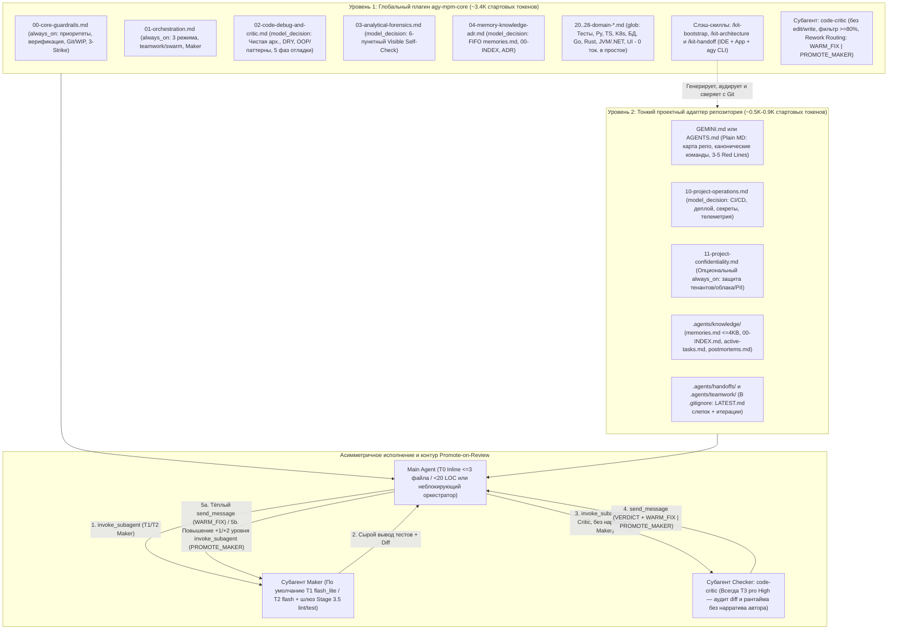

# `gemini-mpm` (`agy-mpm-core`)

**Переносимый набор мультиагентной инженерии, контекстно-изолированного код-ревью и компактных правил для Google Antigravity (IDE, Antigravity 2.0 App и `agy` CLI)**

**[🇬🇧 English](README.md) | [🇷🇺 Русский](README.ru.md)**

`v1.7.0` · **Лицензия MIT** · **0 строк внешних CLI-обёрток** · **`~4.5K` стартовых токенов (`<25%` бюджета)** · **Редакции EN + RU**

---

`gemini-mpm` (`agy-mpm-kit`) упаковывает проверенные продакшеном практики мультиагентной разработки в **100% нативные примитивы Google Antigravity**: сжатые по методу Caveman правила `rules/` (с асимметричной маршрутизацией моделей `Maker < Checker`, динамическим повышением `Promote-on-Review`, протоколом чтения `Read-Once` и по референсам `Symbol-First`, протоколом Knowledge-First Boot и языковыми пакетами `20..28` с нулевым расходом токенов в простое), кросс-интерфейсные слэш-скиллы `/kit-bootstrap`, `/kit-architecture` и `/kit-handoff` (`skills/`) и контекстно-изолированного субагента-ревьюера `code-critic` (`agents/code-critic.md`). Установите ядро один раз глобально как локальный плагин, разворачивайте тонкие проектные адаптеры за ~90 секунд и сохраняйте архитектурную чистоту, экономию бюджета моделей и строгий контроль качества во всех репозиториях без раздувания контекстного окна.

### Быстрый старт за 30 секунд

```bash
git clone https://github.com/asabadyr/gemini-mpm.git ~/Projects/gemini-mpm
cd ~/Projects/gemini-mpm

# Установите глобальный плагин Antigravity (английская или русская редакция)
./install.sh --lang en      # По умолчанию: английское ядро (на ~35-40% меньше токенов)
# ./install.sh --lang ru    # Альтернатива: полностью русское ядро и русские шаблоны адаптера
```

Затем откройте любой репозиторий в **Google Antigravity** (IDE, App или `agy` CLI) и выполните:

```text
/kit-bootstrap --migrate    # Миграция без потерь из GEMINI.md / CLAUDE.md / .cursorrules
/kit-bootstrap --full       # Проектный адаптер для продакшен-сервисов, монорепо и K8s/облака
/kit-bootstrap --lite       # Лёгкий адаптер для библиотек, CLI и небольших утилит
/kit-architecture audit     # Поиск God-файлов (>400/600 LOC), копипаста и нарушений SOLID/OOP
```

---

## Содержание

1. [Мотивация: почему монолитные файлы инструкций ломаются при масштабировании](#1-мотивация-почему-монолитные-файлы-инструкций-ломаются-при-масштабировании)
2. [Истоки и вдохновение (`bobmatnyc/claude-mpm`) — почему нужно `0` строк обёрток](#2-истоки-и-вдохновение-bobmatnycclaude-mpm--почему-нужно-0-строк-обёрток)
3. [Двенадцать ключевых инноваций `agy-mpm-kit`](#3-двенадцать-ключевых-инноваций-agy-mpm-kit)
4. [Диаграмма архитектуры и бюджет токенов](#4-диаграмма-архитектуры-и-бюджет-токенов)
5. [Нативная двуязычность (`EN` в корне vs `RU` в `./ru/`)](#5-нативная-двуязычность-en-в-корне-vs-ru-в-ru)
6. [Четыре топологии установки и мультипроектной работы (гид по `realpath`)](#6-четыре-топологии-установки-и-мультипроектной-работы-гид-по-realpath)
7. [Повседневные рабочие процессы](#7-повседневные-рабочие-процессы)
8. [Полная карта репозитория (`/` EN и `/ru` RU)](#8-полная-карта-репозитория--en-и-ru-ru)
9. [Кастомизация и расширение набора](#9-кастомизация-и-расширение-набора)
10. [Благодарности, атрибуция и лицензия MIT](#10-благодарности-атрибуция-и-лицензия-mit)

---

## 1. Мотивация: почему монолитные файлы инструкций ломаются при масштабировании

Большинство AI-воркфлоу начинаются с одного файла `GEMINI.md` или `CLAUDE.md`, куда после каждого инцидента дописываются новые абзацы. В реальных многосервисных проектах монолитные файлы инструкций неизбежно деградируют по шести причинам:

| Проблема | Как это проявляется на практике |
|---|---|
| **1. Засорение контекстного окна** | Смешивание общих инженерных правил, гайдов по Python/TS/K8s, CI/CD-ранбуков и специфики БД в одном `15–50 KB` файле сжигает **`4,000–13,000+` токенов на каждом шаге** — даже для секундного вопроса о статусе. |
| **2. Размывание внимания в середине промпта** | Длинные прозаические абзацы и блоки `<example>` прячут критические запреты (`🔴`) в «слепой зоне» середины контекста, из-за чего модель пропускает проверки или теряет пункты составного запроса пользователя. |
| **3. Предвзятость самопроверки и эффект якорения** | Когда один и тот же агент проверяет собственный код (или ревьюер читает убедительные оправдания автора в описании изменений), он рационализирует баги вместо попытки их опровергнуть. |
| **4. Тавтологичные, нестабильные и пропущенные тесты** | Агенты регулярно пишут пустые проверки (`assert res is not None`), синхронизируют асинхронный код через `sleep(0.5)`, мокают саму тестируемую систему (SUT) или считают `"0 tests collected"` / `"N skipped"` успешным прогоном. |
| **5. Межсессионная амнезия и устаревшие handoff-заметки** | Архитектурные решения теряются между чатами, а непроверенные заметки прошлой сессии расходятся с реальным `git status`, создавая риск затереть незакоммиченный пользовательский WIP. |
| **6. Рассинхронизация копий и задвоение токенов** | Копирование `.agents/rules/` по 5–20 репозиториям ведёт к мгновенному устареванию правил, а в Antigravity копирование глобальных правил в проект **загружает оба файла одновременно**, незаметно удваивая расход токенов. |

---

## 2. Истоки и вдохновение (`bobmatnyc/claude-mpm`) — почему нужно `0` строк обёрток

`agy-mpm-kit` вдохновлён открытой экосистемой [**`bobmatnyc/claude-mpm`**](https://github.com/bobmatnyc/claude-mpm) Боба Мацуоки (`@bobmatnyc`), включая репозитории [**`claude-mpm-agents`**](https://github.com/bobmatnyc/claude-mpm-agents) и [**`claude-mpm-skills`**](https://github.com/bobmatnyc/claude-mpm-skills).

### Почему `claude-mpm` потребовалась Python CLI-обёртка — и почему в Antigravity она не нужна

В экосистеме Claude Code проект `claude-mpm` вырос в Python-фреймворк на ~250 файлов (Click, FastAPI, Socket.IO) вокруг бинарника `claude`, поскольку:
1. Плагины Claude Code загружались *после* формирования системного промпта и не могли инжектировать инструкции оркестратора до первого хода модели.
2. Из-за апстрим-бага маршрутизации поле `model:` во фронтматтере субагентов игнорировалось, требуя Python-хука `PreToolUse` (`model_tier_hook.py`).
3. Субагенты были одноразовыми вызовами без сохранения состояния (перезагрузка `~95K` токенов на каждую правку по линтеру/тестам), а для мониторинга требовался отдельный Socket.IO + Svelte веб-сервер.

**Google Antigravity решает 100% этих инфраструктурных задач нативно.** Поэтому `agy-mpm-kit` содержит **`0` строк Python CLI, демонов, Socket.IO или обёрточных хуков**:

| Механизм | `claude-mpm` (`v6.5+`) | `agy-mpm-kit` в Google Antigravity |
|---|---|---|
| **Загрузка правил до хода и прогрессивное раскрытие** | Python CLI-обёртка сборки промпта + скрипт `build-agent.py` | Нативная загрузка `GEMINI.md` / `.agents/rules/*.md` / `rules/` плагина с триггерами `always_on`, `model_decision`, `glob`, `manual` и `@[label](path)` |
| **Маршрутизация моделей и песочниц субагентов** | Python-хук `PreToolUse` (`model_tier_hook.py`) | Нативный `invoke_subagent(Model="flash_lite"\|"flash"\|"pro"\|"inherit", Workspace="inherit"\|"branch"\|"share")` |
| **Доработка замечаний и UI мониторинга агентов** | Повторный холодный запуск + внешний Socket.IO/Svelte сервер | Тёплые субагенты с реактивным пробуждением через **`send_message(Recipient=conversationId)`** (0 токенов на перезагрузку!) + нативный UI Subagents/Tasks |
| **Планирование, автономные кампании и обучение** | Собственные CLI-команды и хуки | Нативные `/plan`, `/grill-me`, `/boost`, `/teamwork`, `/goal`, `/compact`, `/learn` + кросс-интерфейсные скиллы `/kit-bootstrap`, `/kit-architecture` и `/kit-handoff` |
| **Безопасность грязного Git-дерева и мультирепо** | Догма `ONE FILE PER COMMIT`, авто-коммит после каждой фазы и допущение корневого `.git` | **Усилено**: защита незакоммиченного WIP, стейджинг строго по явным путям `git add <file>` и проверка `<workspace>/.git` для зонтичных мультирепо |

---

## 3. Двенадцать ключевых инноваций `agy-mpm-kit`

### 1. Табличное Caveman-сжатие промптов и формат делегирования HSDF
Основано на эмпирических бенчмарках MPM, где перевод многословных инструкций (`47 KB` / `~12.7K` токенов) в плотные таблицы решений (`10.8 KB` / `~2.7K` токенов) сократил системный промпт на **`-77%`**, общий расход токенов сессии — на **`-47%`**, и **повысил соблюдение критериев качества на `+17%` (`3.75/5 -> 4.40/5`)**. Задачи субагентам передаются в формате **HSDF (Hybrid Structured Delegation Format)** (`tier`, `Effort`, `task`, `scope_allowlist`, `contracts`, `observable`, `return`, `context`), который никогда не сжимает точные пути к файлам, номера строк, имена инструментов и стектрейсы.

### 2. Двухуровневая архитектура (Универсальное Ядро vs Тонкий Проектный Адаптер)
Разделяет **Уровень 1 (глобальный плагин `agy-mpm-core`)** — побайтово идентичный для проектов на Python, TypeScript, Go, Rust, JVM/.NET, Frontend UI и Kubernetes — и **Уровень 2 (тонкий адаптер конкретного репозитория)**, создаваемый через `/kit-bootstrap`. Стартовый бюджет сессии удерживается на уровне **`~3.8K` токенов** (`<20%` от лимита Antigravity `defaultRulesBudget = 20,000`), а предметные и языковые `glob`-правила (`20..28`) стоят **`0` токенов** в простое и подключаются только при работе с соответствующими файлами.

### 3. Контекстно-изолированный ревьюер `code-critic`
`agents/code-critic.md` задаёт специализированного субагента-проверяющего (Checker) с урезанной поверхностью инструментов `[read_file, run_command, manage_task, send_message]` (без `edit_file` и `write_file`). При вызове оркестратор **удаляет словесные оправдания автора кода (Maker)**, передавая только ТЗ, контракты, `git diff`, сырой вывод тестов и проверяемый рантайм-артефакт. `code-critic` публикует только находки с уверенностью **`>=80%`**, применяет ужесточённую матрицу вердиктов (**любой дефект `CRITICAL` или `HIGH` => обязательный `BLOCK`**) и автоматически включает **OWASP + multi-tenant аудит безопасности** при изменениях в auth/JWT, криптографии/секретах, SQL/NoSQL-запросах, запуске shell-процессов, путях/загрузке файлов, десериализации или изоляции тенантов.

### 4. 5-фазная систематическая отладка + предохранитель «3 попыток» (3-Strike Stop)
Правило `02-code-debug-and-critic.md` запрещает хаотичные патчи наугад и требует прохождения 5 последовательных фаз: **1. Детерминированное воспроизведение -> 2. Изоляция (`git bisect` / минимальный вход) -> 3. Трассировка первопричины назад по стеку -> 4. Исправление первопричины (запрет на маскирующие `try/catch`, `sleep` и слепые ретраи) -> 5. Регрессионный тест, падающий без фикса**. Если **3 попытки** исправить один и тот же баг/тест провалились, `00-core-guardrails.md` активирует **правило 3-Strike Stop**: остановить хождение по кругу, свести опровергнутые гипотезы, поставить под сомнение архитектурную предпосылку и эскалировать варианты пользователю.

### 5. 6-пунктная видимая самопроверка аналитики и форензики данных
При подготовке метрик, отчётов по облачным расходам/утилизации, подсчётов и долей по БД, бенчмарков или разбора логов правило `03-analytical-forensics.md` требует обязательного блока **`Visible Self-Check`** по 6 инвариантам: (1) размерность и единицы измерения (`s` vs `ms`, `MiB` vs `GiB`, раздувание base64 `× 4/3`), (2) семантика агрегации временных рядов (взвешивание gauge-метрик по длительности вместо суммирования средних по окну / `avg_over_time`), (3) чистота знаменателя и учёт удалённых записей (`deleted: false`), (4) сравнение с контрольной когортой, (5) проверка реального артефакта вместо шаблона и (6) фальсификация одной гипотезы за раз.

### 6. Инспектор качества тестов и 3-уровневая пирамида контрактов
Объединяет `00-core-guardrails.md` и `20-domain-tests-and-contracts.md` для защиты от бутафорских тестов:
- **Защита от тихого пропуска и чужого окружения**: `"0 tests collected"`, `"N skipped"` на целевом коде, пустой `stdout` или запуск вне реального окружения проекта (`uv`, `poetry`, `.venv`) немедленно **блокируют** приёмку.
- **Анти-тавтология и мысленная мутация**: запрет проверок вида `assert res is not None` / `toBeDefined()` и обязательный вопрос: *«если инвертировать целевой `if` или заменить `<` на `<=` в продакшен-коде, упадёт ли хотя бы один тест?»*
- **Детерминированный async и чистота прод-классов**: запрет фиксированных `sleep()` / `setTimeout()` в пользу поллинга условий с таймаутом (`waitFor`), запрет мокирования внутренних методов SUT и запрет тестовых методов `_for_testing()` в продакшен-классах.
- **3-уровневая пирамида контрактов**: (L1) юнит-тесты постусловий и границ, (L2) property-based тесты с кодированием предусловий прямо в генераторах (`hypothesis` / `fast-check`), (L3) негативные тесты нарушения предусловий.

### 7. Защита грязного Git-дерева и зонтичных мультирепо без корневого `.git`
Спроектировано для реальных рабочих пространств с незакоммиченным локальным WIP и папок с десятками микросервисов:
- **Защита WIP и секретов**: строгий запрет `git checkout <file>`, `git restore <file>`, `git reset --hard`, `git clean` на нетронутых файлах и запрет массового стейджинга (`git add .`, `git add -A`, `git commit -a`). Разрешён только пофайловый стейджинг целевых путей с проверкой `git status -s` и `git show --stat HEAD`, а любые совпадения с паттернами секретов (`sk-`, `ghp_`, `AKIA`, `npm_`, `xox`, `AIza`, PEM) останавливают коммит.
- **Проверка `<workspace>/.git`**: перед передачей `Workspace="share"` или `"branch"` в `invoke_subagent` проверяется наличие `<workspace>/.git`. В зонтичных мультирепо без корневого `.git` (где `.git` лежит внутри подпроектов `<subrepo>/.git`) агенты автоматически работают через `Workspace="inherit"` с непересекающимся владением подрепозиториями или через явный `git -C <subrepo> worktree add` — без падений worktree и без создания фиктивных `.git/info/exclude` в корне.

### 8. Типизированная `FIFO`-память `memories.md` (`<=4 KB`) + матрица хронологического приоритета
`04-memory-knowledge-adr.md` автоматически перехватывает постоянные указания пользователя (`"запомни"`, `"всегда"`, `"никогда"`, `"впредь"`) в виде однострочных датированных фактов (`- [YYYY-MM-DD] <факт>`) в 5 секциях с жёсткими квотами: `CRITICAL` (макс. `20`, без авто-вытеснения), `Environment` (`15`), `Decisions` (`20`), `Patterns` (`20`) и `Gotchas` (`15`) по дисциплине **FIFO (вытеснение самой старой записи сверху секции)** при общем лимите **`<=4 KB`**. Крупные разборы выносятся в `postmortems.md` под управлением **Матрицы хронологического авторитета (`00-INDEX.md`)** (при противоречии побеждает более свежая дата верификации + живой код), дополненной **3-критериальным фильтром ADR по Нейгарду** и связкой с `/learn`.

### 9. Очищенные от секретов 7-секционные слепки сессий (`LATEST.md`)
Команда `/kit-handoff pause` работает безопасно и не прерывает активных фоновых субагентов: она маскирует секреты в `<REDACTED:VAR_NAME>`, проверяет наличие `.agents/handoffs/` в `.gitignore` и сохраняет компактный 7-секционный слепок `.agents/handoffs/LATEST.md` (`<=10K` токенов). При вызове `/kit-handoff resume` агент **обязательно сверяет `LATEST.md` с живым выводом `git status -s` и `git log --oneline -10`**, отдавая безусловный приоритет реальному состоянию Git.

### 10. Чистая архитектура, защита от God-файлов, DRY, OOP/паттерны и языковые пакеты (`20..28` + `/kit-architecture`)
Предотвращает спагетти-код, размножение копипаста и монолитные файлы, чётко разделяя **Основной продакшен-код** (строгий режим по умолчанию) и **Одноразовые прототипы / `scratch/`** (допускается одиночный файл `<200–300` LOC без лишних абстракций со строгим запретом импорта в продакшен):
- **Жёсткие лимиты размера и сложности (`02` + `code-critic`)**: планирование декомпозиции файла на **`400` LOC** (жёсткий потолок **`600` LOC**), **`<=300` LOC** на класс (`<=200` LOC для UI-компонентов), **`<=30/50` LOC** на функцию, цикломатическая сложность **`<=10`** и глубина вложенности **`<=3`** за счёт ранних выходов (guard clauses).
- **Поиск перед созданием и DRY-дедупликация**: обязательный поиск существующих хелперов до написания нового кода, принцип **Одна реализация на фичу** (немедленное удаление устаревших параллельных веток) и вынос переиспользуемых функций/коллабораторов при совпадении **`2+` блоков на `>80%`** или **`>=30` LOC** (с защитой от ложного DRY между разными бизнес-доменами).
- **Практические OOP, SOLID и паттерны проектирования**: композиция вместо глубокого наследования (`глубина <=2`), Constructor Dependency Injection и таблица перевода запахов кода в паттерны (`3+` повторяющихся веток `if/else`/`switch` -> **Strategy / Реестр обработчиков**, утечка SQL/ORM в домен -> **Repository**, внешние API/SDK -> **Adapter / Anti-Corruption Layer**, сложная сборка объектов -> **Factory / Builder**, циклические зависимости -> **Domain Events**, каскадные отказы -> **Circuit Breaker**).
- **Языковые пакеты лучших практик без расхода токенов в простое**: `9` `glob`-правил (`20..28`: Тесты/Контракты, Python, TypeScript/Node.js, K8s/Infra, SQL/MongoDB, Go, Rust, Java/Kotlin/C# `.NET` и Frontend UI React/Next/Vue/Svelte) плюс скилл `/kit-architecture` со справочниками по **12 языковым экосистемам** (`+ PHP, Ruby, Elixir/OTP, Swift/Dart, C/C++`) и протоколом безопасного пошагового рефакторинга God-файлов чанками `<=200` LOC.

### 11. Асимметричная маршрутизация `Maker < Checker` (`T0..T3`), скоростная 5-ролевая матрица и динамическое повышение модели (`Promote-on-Review`)
Переопределяет встроенный дефолт Antigravity `Model="inherit"` (из-за которого даже тривиальные задачи уходят на максимальную модель и `Effort: High`) трёхуровневым протоколом оркестрации в `01-orchestration.md` и `agents/code-critic.md`:
- **3 режима исполнения**:
  1. **Режим 1 (`T0` Inline в Main Agent)**: чтение `<=3` файлов, Q&A по архитектуре, точечная правка `<20` LOC в 1 шаг без запуска фоновых агентов.
  2. **Режим 2 (Скоростная 5-ролевая матрица `Роль -> Модель + Effort` через `teamwork` и `swarm`)** *(Основной)*: устраняет задержки долгих прогонов, сохраняя бескомпромиссную приёмку. Оркестратор (`Sentinel`/координатор) и Разработчик/Тестировщик (`teamwork_worker`) работают на **`<fast-workhorse-model> (High)`** для мгновенной координации и быстрых тестов; Исследователь/Аналитик (`teamwork_explorer`) и Постановщик задания (`teamwork_interviewer`) — на **`<frontier-model> (Medium)`**; а все ревьюеры (`code-critic`, `teamwork_reviewer`, `teamwork_challenger`, `teamwork_victory_auditor`) — строго на **`<frontier-model> (High)`**. При ясности ТЗ `>=90%` используется быстрый старт `[skip-interview]`, а состояние изолируется в `.agents/teamwork/` (в `.gitignore`). В нативном `swarm` пиннинг выполняется через `swarm{action:"add", model:"<exact-model-id>"}`, а живое повышение модели на месте — через `swarm{action:"model"}`.
  3. **Режим 3 (Резервный грубый `invoke_subagent`)**: асимметричная связка Maker (`flash_lite`/`flash`) + Checker (`pro`/`inherit` High) по шкале `T1..T3`, когда точный пиннинг не требуется или `teamwork`/`swarm` недоступны.
- **Шлюзы Knowledge-First Boot (`knowledge_refs`), Cache-First (`🟡`) и анти-латентность**: каждый субагент обязан на Шаге 0 прочитать `GEMINI.md`, `00-INDEX.md`, `memories.md` и целевые доки ДО любых слепых `find`/`grep` (запрет cold survey); если `>=75%` данных уже в кэше — обработка выполняется inline или лёгким хелпером `T1`; задачи `<=3` файлов решаются inline без запуска тяжёлых субагентов.
- **Повышение модели по ходу ревью шагов (`Promote-on-Review`)**: `code-critic` классифицирует доработку как `WARM_FIX` (локальная правка через тёплый `send_message`) либо `PROMOTE_MAKER` (повышение Разработчика от `<fast-workhorse-model> (High)` до `<frontier-model> (High)`: `iterN+1` в `teamwork`, `swarm{action:"model"}` в рое или свежий `invoke_subagent(Model="pro", Effort="High")` с отсечением ложных рассуждений автора).

### 12. Протокол чтения `Read-Once` и по референсам кода (Symbol-First & Grep-Before-Read)
Предотвращает засорение контекстного окна, перерасход токенов и задержки ходов от повторных перечитываний, бесцельного серфинга по нерелевантным файлам и слепого шагания мелкими кусками по большим модулям:
- **Калибровка области чтения по типу задачи (без «выстрелов в ногу»)**:
  * **Целевая разработка и багфиксы**: предписывает исследовать `scope_allowlist`, целевые тесты и **любые реальные референсы по коду** (`import`, базовые классы, интерфейсы, вызывающие и вызываемые методы, общие типы и конфиги) сквозь файлы на любую глубину цепочки вызовов, необходимую для корректности. Запрещает *только* чтение нереференсных файлов «на всякий случай» (соседние реализации, конфиги других сред, слепые дампы директорий), не имеющих кодовой связи или поискового хита.
  * **Общий анализ, аудит DRY и поиск похожих мест**: кросс-модульный `grep -rn` и чтение по кодовой базе **явно не ограничены** — агенты находят кандидатов через `00-INDEX.md` + `grep -rn`, после чего читают точно совпавшие диапазоны.
- **4 универсальных правила против лишних шагов (для всех агентов)**:
  1. **`Read-Once` (без повторов)**: никогда не перечитывать неизменённый диапазон `(file, lines)` дважды в одной сессии; сохранять контракты и выводы в рабочих заметках.
  2. **Без слепой нарезки по 100 строк**: небольшие и связные модули `<=600–800` строк брать за **1** вызов `read_file` (до максимума тула `800` строк), а не дробить на куски `1-100`, `101-200`, `201-350`.
  3. **`Grep-Before-Read` для крупных файлов (`>400` строк)**: сначала выполнить `grep -n` для определения точных номеров строк нужного символа/класса, затем взять **1** целевой блок вокруг хита (в том числе при переходе по `import` в другой крупный файл).
  4. **Передача якорей `read_anchors:` (`Explorer -> Developer`)**: артефакты `Explorer` и `Task Setter` (`handoff.md`, `DISPATCH.md`) передают точные якоря `file:start-end | символ | референсы` в формате HSDF, чтобы Разработчик сразу открывал нужные строки без повторного холодного поиска (сохраняя полное право дочитать найденные по коду ссылки).

---

## 4. Диаграмма архитектуры и бюджет токенов



### Полная таблица файлов и бюджета токенов

Каждый файл правил занимает `<35%` от жёсткого лимита Antigravity (`24,000` байт на файл), а суммарная стартовая нагрузка составляет **`<20%` от бюджета `defaultRulesBudget` (`20,000` токенов)**:

| Слой | Файл | Триггер | Размер на диске (EN) | Токены на старте | Токены по требованию |
|---|---|---|---|---|---|
| **Ядро (Ур. 1)** | `rules/00-core-guardrails.md` | `always_on` | `4,402 B` (`4.4 KB`) | `~1,100` | *(Уже загружен)* |
| **Ядро (Ур. 1)** | `rules/01-orchestration.md` | `always_on` | `17,991 B` (`18.0 KB`) | `~4,490` | *(Уже загружен)* |
| **Ядро (Ур. 1)** | `rules/02-code-debug-and-critic.md` | `model_decision` | `8,525 B` (`8.5 KB`) | `~45` *(описание)* | `~2,130` |
| **Ядро (Ур. 1)** | `rules/03-analytical-forensics.md` | `model_decision` | `2,542 B` (`2.5 KB`) | `~35` *(описание)* | `~635` |
| **Ядро (Ур. 1)** | `rules/04-memory-knowledge-adr.md` | `model_decision` | `3,344 B` (`3.3 KB`) | `~35` *(описание)* | `~835` |
| **Домены (Ур. 1)** | `rules/20-domain-tests-and-contracts.md` | `glob` *(тестовые файлы)* | `3,082 B` (`3.1 KB`) | **`0`** | `~770` |
| **Домены (Ур. 1)** | `rules/21-domain-python.md` | `glob` (`*.py`, `pyproject.toml`) | `2,978 B` (`3.0 KB`) | **`0`** | `~745` |
| **Домены (Ур. 1)** | `rules/22-domain-typescript-node.md` | `glob` (`*.ts`, `*.tsx`, `*.js`) | `2,890 B` (`2.9 KB`) | **`0`** | `~725` |
| **Домены (Ур. 1)** | `rules/23-domain-k8s-and-infra.md` | `glob` (`*.yaml`, `Dockerfile`, `*.tf`, `*.sh`) | `2,235 B` (`2.2 KB`) | **`0`** | `~560` |
| **Домены (Ур. 1)** | `rules/24-domain-sql-mongo-migrations.md` | `glob` (`migrations/**`, `*.sql`, `*schema*`) | `2,186 B` (`2.2 KB`) | **`0`** | `~545` |
| **Домены (Ур. 1)** | `rules/25-domain-go.md` | `glob` (`*.go`, `go.mod`, `go.sum`) | `3,286 B` (`3.3 KB`) | **`0`** | `~820` |
| **Домены (Ур. 1)** | `rules/26-domain-rust.md` | `glob` (`*.rs`, `Cargo.toml`) | `3,080 B` (`3.1 KB`) | **`0`** | `~770` |
| **Домены (Ур. 1)** | `rules/27-domain-jvm-and-dotnet.md` | `glob` (`*.java`, `*.kt`, `*.cs`, `pom.xml`, `*.csproj`) | `3,170 B` (`3.2 KB`) | **`0`** | `~795` |
| **Домены (Ур. 1)** | `rules/28-domain-frontend-ui.md` | `glob` (`*.tsx`, `*.jsx`, `*.vue`, `*.svelte`, `*.css`) | `3,395 B` (`3.4 KB`) | **`0`** | `~850` |
| **Скиллы (Ур. 1)** | `skills/kit-architecture/SKILL.md` (+ 3 справочника) | Слэш `/kit-architecture` | `4,287 B` (`4.3 KB`) | `~40` *(описание)* | `~1,070` *(+ refs)* |
| **Скиллы (Ур. 1)** | `skills/kit-bootstrap/SKILL.md` (+ 8 шаблонов) | Слэш `/kit-bootstrap` | `13,240 B` (`13.2 KB`) | `~45` *(описание)* | `~3,310` |
| **Скиллы (Ур. 1)** | `skills/kit-handoff/SKILL.md` (+ 1 шаблон) | Слэш `/kit-handoff` | `4,238 B` (`4.2 KB`) | `~35` *(описание)* | `~1,060` |
| **Агент (Ур. 1)** | `agents/code-critic.md` | Субагент `code-critic` | `7,794 B` (`7.8 KB`) | `~40` *(описание)* | `~1,950` *(изолированно)* |
| **Фоллбэк (Ур. 1)** | `extras/manual-rules-fallback/90..92` | `manual` (`@90...`, `@91...`, `@92...`) | `12,878 B` *(3 файла)* | **`0`** | *Фоллбэк IDE/App* |
| **Адаптер (Ур. 2)** | `<repo>/GEMINI.md` *(или `AGENTS.md`)* | Plain MD (`always_on`) | `~1.8–2.5 KB` | `~450–625` | *(Уже загружен)* |
| **Адаптер (Ур. 2)** | `.agents/rules/10-project-operations.md` | `model_decision` *(`--full`)* | `~2.0–5.0 KB` | `~35` *(описание)* | `~500–1,250` |
| **Адаптер (Ур. 2)** | `.agents/rules/11-project-confidentiality.md` | `always_on` *(опционально)* | `~1.1–1.5 KB` | `~275–375` *(опц.)* | *(Уже загружен)* |
| **Знания (Ур. 2)** | `.agents/knowledge/*` и `handoffs/LATEST.md` | Чтение по запросу | `<=4 KB` (`memories.md`) | **`0`** | Точечное чтение |
| **ИТОГО** | **Базовый старт сессии (`Ядро + Адаптер`)** | — | — | **`~5,155` токенов** (`~5.5K` с `11-*`) | **`~25.8%` от лимита `20K`** |

---

## 5. Нативная двуязычность (`EN` в корне vs `RU` в `./ru/`)

Репозиторий `agy-mpm-kit` содержит две полностью автономные редакции плагина:
- **Английская редакция (`/` — корень репозитория)** — правила (`00..04`, `20..28`), скиллы (`/kit-bootstrap`, `/kit-architecture`, `/kit-handoff`), `code-critic` и шаблоны проектного адаптера на английском языке.
- **Русская редакция (`./ru/` — каталог `ru`)** — 100% нативная русская версия всех правил, скиллов, `code-critic`, manual-плейбуков и шаблонов `/kit-bootstrap` + `/kit-handoff` (`GEMINI.md`, `memories.md`, `00-INDEX.md`, `LATEST.md`).

Поскольку слот плагина `~/.gemini/config/plugins/agy-mpm-core` представляет собой **один симлинк**, указывающий *либо* на `<repo>` (`EN`), *либо* на `<repo>/ru` (`RU`), **две редакции никогда не загружаются одновременно** — задвоение правил полностью исключено.

| Критерий | Редакция `EN` (`--lang en`, по умолчанию) | Редакция `RU` (`--lang ru`, `./ru/`) |
|---|---|---|
| **Стартовый расход токенов** | **`~3.8K` токенов** (на ~35–40% компактнее в BPE-токенизаторах LLM) | **`~5.1K–5.8K` токенов** (кириллическая токенизация; всё ещё `<29%` от бюджета `20K`) |
| **Язык общения в чате** | Агент свободно отвечает **на русском, английском или любом языке** вашего запроса | Агент отвечает на русском с русскими заголовками отчётов и самопроверок |
| **Шаблоны адаптера (`/kit-bootstrap`)** | Генерирует `GEMINI.md`, `memories.md`, `00-INDEX.md`, `LATEST.md` **на английском** | Генерирует `GEMINI.md`, `memories.md`, `00-INDEX.md`, `LATEST.md` **на русском** |
| **Когда выбирать** | Максимальная экономия контекста, международные/OSS-репозитории, смешанные проекты | Русскоязычные команды, предпочитающие вести проектную базу знаний и память на русском |

### Переключение одной командой (`install.sh`)

```bash
./install.sh --lang en      # Направить ~/.gemini/config/plugins/agy-mpm-core -> <repo>
./install.sh --lang ru      # Направить ~/.gemini/config/plugins/agy-mpm-core -> <repo>/ru
./install.sh --status       # Проверить текущий симлинк, версию и активную редакцию
./install.sh --uninstall    # Безопасно удалить симлинк (не трогает реальные директории)
```

<details>
<summary><strong>Ручная установка через <code>ln -s</code> (без <code>install.sh</code>)</strong></summary>

```bash
mkdir -p ~/.gemini/config/plugins
rm -f ~/.gemini/config/plugins/agy-mpm-core

# Английская редакция:
ln -s ~/Projects/gemini-mpm ~/.gemini/config/plugins/agy-mpm-core

# ИЛИ русская редакция:
ln -s ~/Projects/gemini-mpm/ru ~/.gemini/config/plugins/agy-mpm-core
```
</details>

---

## 6. Четыре топологии установки и мультипроектной работы (гид по `realpath`)

> [!CAUTION]
> **Критический инвариант Antigravity: дедупликация только по `realpath` и суммирование правил**
> Antigravity дедуплицирует файлы правил **строго по физическому пути на диске (`realpath`)**, а не по хешу содержимого, при этом правила глобального и проектного уровней **суммируются**.
> **НИКОГДА не копируйте (`cp`) файлы Универсального Ядра (`00..04`, `20..28`) в `<repo>/.agents/rules/`, пока включён глобальный плагин `agy-mpm-core`!** Два физических файла имеют разные `realpath` и будут загружены в промпт **дважды**, удваивая расход токенов.

Выберите схему под модель совместной работы в конкретном проекте:

### Режим A (Рекомендуемый для личных и мультипроектных рабочих мест): Глобальный локальный плагин + Тонкий адаптер
Установите `agy-mpm-core` один раз глобально через `./install.sh --lang en` (или `--lang ru`). Внутри каждого рабочего репозитория храните **только** проектный адаптер Уровня 2 (`GEMINI.md`, опциональные `10-*`/`11-*`, `.agents/knowledge/`).
- **Отключение/включение в 1 клик**: управляйте плагином на лету без перезапуска IDE через `/plugin` или ссылку `customization://agy-mpm-core` (ссылка всегда строится по имени директории `agy-mpm-core`; никогда не редактируйте `~/.gemini/config/config.json` вручную).
- **Работа внутри подпроектов мультирепо**: так как плагин глобальный (`isGlobal: true`), правила ядра продолжают работать даже при открытии отдельного подрепозитория (`<umbrella>/<service>/`), где обход `.agents/` вверх по дереву останавливается на `<service>/.git`.

### Режим B (Командный репозиторий в Git)
Когда команде нужно закоммитить весь набор правил, скиллов и `code-critic` прямо в `<team-repo>/.agents/{rules,skills,agents}/`, чтобы он работал у коллег сразу после `git clone` без установки плагина:
1. Закоммитьте правила, скиллы и `code-critic.md` в `<team-repo>/.agents/`.
2. На своей машине **отключите глобальный плагин `agy-mpm-core` в 1 клик** через `/plugin` (`customization://agy-mpm-core`) на время работы с `<team-repo>` *(либо создайте в `<team-repo>/.agents/rules/` локальные симлинки `ln -s` на `~/Projects/gemini-mpm/rules/` — одинаковый `realpath` гарантирует однократную загрузку)*.

### Режим C (Персональный «невидимый» оверлей поверх чужого/командного репо через `.git/info/exclude`)
Когда вы работаете в корпоративном или open-source репозитории и **не хотите** добавлять `GEMINI.md` и `.agents/` в коммиты и pull request'ы команды:
1. Оставьте глобальный плагин `agy-mpm-core` включённым.
2. Запустите `/kit-bootstrap` и выберите режим **`Personal overlay on shared repo`**.
3. Скилл пропишет `GEMINI.md`, `AGENTS.md` и `.agents/` в локальный `<repo>/.git/info/exclude` (**строго если `<repo>/.git` существует как реальная Git-директория**; в корне зонтичного мультирепо без `.git` файлы адаптера и так находятся вне Git дочерних подпроектов, поэтому фиктивный `.git/info/exclude` никогда не создаётся). Итог: **нулевой след в `git status` и PR команды**.

### Режим D (Чистый фоллбэк на правилах без `skills/` для IDE и App)
Если окружение разрешает использовать только `.agents/rules/*.md` без каталога `skills/`:
1. Скопируйте или подключите симлинком `extras/manual-rules-fallback/90-playbook-bootstrap.md`, `91-playbook-handoff.md` и `92-playbook-architecture.md` (`trigger: manual`, `0` токенов в простое) в `.agents/rules/`.
2. Вызывайте их в чате **Antigravity IDE** или **Antigravity 2.0 App** через `@90-playbook-bootstrap.md`, `@91-playbook-handoff.md` и `@92-playbook-architecture.md`.
3. *Ограничение платформы*: **`agy` CLI не поддерживает `@`-упоминания правил** — для работы в терминальном `agy` CLI используйте режимы A–C со скиллами (`skills/`).

| Топология | Где лежит Ядро (Ур. 1) | Где лежит Адаптер (Ур. 2) | Защита от задвоения токенов | Поддержка `agy` CLI |
|---|---|---|---|---|
| **Режим A: Глобальный плагин** *(Рекомендуется)* | Симлинк `~/.gemini/config/plugins/agy-mpm-core` | `<repo>/GEMINI.md` + `.agents/{rules/10-*,knowledge}` | Единственная физическая копия ядра | Да (`/kit-*`) |
| **Режим B: Командный репо в Git** | `<team-repo>/.agents/{rules,skills,agents}` | `<team-repo>/GEMINI.md` + `.agents/{rules/10-*,knowledge}` | Выключение `agy-mpm-core` в `/plugin` (или `ln -s` с единым `realpath`) | Да (`/kit-*`) |
| **Режим C: Невидимый оверлей** | Симлинк `~/.gemini/config/plugins/agy-mpm-core` | Локальные `GEMINI.md` + `.agents/` в `.git/info/exclude` | Единственная копия ядра + локальный exclude | Да (`/kit-*`) |
| **Режим D: Фоллбэк без скиллов** | `rules/` + `90..92-playbook-*.md` (`manual`) | `<repo>/GEMINI.md` + `.agents/knowledge/` | Единый каталог правил | Только IDE и App (`@90...`) |

---

## 7. Повседневные рабочие процессы

### 7.1 Подключение нового проекта (`/kit-bootstrap --lite` vs `--full`)

- **`/kit-bootstrap --lite`** *(~90 сек — библиотеки, CLI-утилиты, `<5` модулей)*:
  Сканирует манифесты стека (`package.json`, `pyproject.toml`, `go.mod`, `Cargo.toml` и др.) и `git log`, задаёт **один** подтверждающий вопрос через `ask_question`, создаёт лаконичный `GEMINI.md` без YAML-фронтматтера (`~1.8 KB`), предзаполненный `.agents/knowledge/memories.md` и добавляет `.agents/handoffs/` и `.agents/teamwork/` в `.gitignore`.
- **`/kit-bootstrap --full`** *(~90 сек — продакшен-сервисы, монорепо, зонтичные мультирепо, K8s/облако)*:
  Дополнительно создаёт `.agents/rules/10-project-operations.md` (`model_decision` — убирает CI/CD, деплой в K8s, карты неймспейсов и скрипты секретов из обычных кодовых ходов), опциональный `.agents/rules/11-project-confidentiality.md` (`always_on`) и каркас базы знаний `.agents/knowledge/{00-INDEX.md, active-tasks.md, postmortems.md}`.
- **Автоматическое повышение до `--migrate`**: если при запуске `--lite` или `--full` в репозитории обнаруживаются уже существующие файлы инструкций агентов, скилл **автоматически переключается в `--migrate`**, защищая проект от перезаписи.

### 7.2 Бесшовная миграция существующих репозиториев (`/kit-bootstrap --migrate`)

Переносит исторические и кросс-агентные правила в тонкий адаптер Уровня 2 за 5 верифицируемых шагов:
1. **Исчерпывающий поиск правил**: сканирует `GEMINI.md`, `AGENTS.md` (в корне и подпапках), `.agents/rules/*.md`, устаревшие `.agents/workflows/*.md`, `CLAUDE.md`, `.claude/**`, `.cursorrules`, `.cursor/rules/**`, `.windsurfrules`, `CODEX.md`, `.remember/**` и секции для AI-агентов в `CONTRIBUTING.md`.
2. **Шлюз бэкапа без потерь (Lossless Backup Gate)**: до изменения любого файла в проекте копирует все найденные оригиналы с сохранением относительных путей в `<appDataDir>/brain/<conversation-id>/scratch/rule-migration-backup/`.
3. **Матрица 4 корзин (4-Bucket Triage Matrix)**:
   - *Корзина 1 (Дубликаты Универсального Ядра)* -> **Отбрасываются** (уже покрыты правилами `00..04` и `20..28`, мгновенно освобождая бюджет промпта).
   - *Корзина 2 (Поведенческие конфликты)* -> **Выносятся в `ask_question`** (например, небезопасные авто-коммиты или пропуск тестов).
   - *Корзина 3 (Идентичность и Red Lines)* -> **Сжимаются** в чистый plain-Markdown `GEMINI.md` (или общий `AGENTS.md` для мульти-инструментальных команд с Claude Code + Cursor + Antigravity) с сохранением/настройкой матрицы профилей `Роль -> Точная модель + Effort` (для `teamwork`/`swarm`) и блока `knowledge_refs`.
   - *Корзина 4 (Ops, подпроекты, знания и воркфлоу)* -> **Раскладываются** по `10-project-operations.md` (`model_decision`), `11-project-confidentiality.md` (`always_on`), опциональным `12-<subproject>.md` (`trigger: glob`, `globs: "**/<subdir>/**"`), базе `.agents/knowledge/*`, а устаревшие `.agents/workflows/*.md` конвертируются в `.agents/skills/<name>/SKILL.md`.
4. **Единое подтверждение через `ask_question`**: согласовывает план триажа, режим коллаборации (Режим A / B / C / мульти-инструментальный `AGENTS.md`) и необходимость `11-project-confidentiality.md`.
5. **Обязательный аудит без потерь через `code-critic`**: запускает субагента `code-critic` (`Model="pro"`, `Effort: High`), который сверяет сгенерированный адаптер с бэкапом в `scratch/rule-migration-backup/` и блокирует завершение, если был потерян **хотя бы один проектный инвариант, каноническая команда, регулярное выражение, маппинг неймспейсов или ссылка**.

### 7.3 Пауза, возобновление сессий и накопление опыта (`/kit-handoff` и `/learn`)

- **`/kit-handoff pause`**: проверяет список фоновых задач и субагентов без их прерывания, редактирует секреты (`sk-`, `ghp_`, `AKIA`, `npm_`, `xox`, `AIza`, PEM, Bearer-токены), гарантирует наличие `.agents/handoffs/` и `.agents/teamwork/` в `.gitignore` и записывает `.agents/handoffs/LATEST.md` (`<=10K` токенов). При продолжении длинной беседы рекомендует `/compact`.
- **`/kit-handoff resume`**: читает `LATEST.md` + `memories.md` и **сверяет их с живым `git status -s` и `git log --oneline -10`** (в корневом `.git` или по дочерним подрепозиториям `*/*/.git`). При любом расхождении побеждает реальное состояние Git.
- **`/kit-handoff postmortem`**: анализирует ошибки сессии, `BLOCK`-вердикты `code-critic` и срабатывания 3-Strike по логам диалога, записывает однострочные выводы в `FIFO`-секции `memories.md` (+ подробные разборы в `postmortems.md`) и рекомендует нативную команду **`/learn`**, когда урок заслуживает превращения в глобальное правило или скилл.

### 7.4 Чистая архитектура, безопасный рефакторинг God-файлов и практики 12 языков (`/kit-architecture`)

- **`/kit-architecture audit [путь]`**: количественно сканирует файлы `>400/600` LOC, классы `>300` LOC, функции `>50` LOC, вложенность `>3`, дублирующиеся блоки `>80%`, прямое создание клиентов БД/HTTP внутри бизнес-логики и повторяющиеся цепочки `if/else`/`switch`, отделяя **Основной продакшен-код** от прототипов в `scratch/`.
- **`/kit-architecture refactor <цель>`**: декомпозирует монолитные God-файлы на `600–5,000+` LOC безопасными, сохраняющими поведение шагами по **`<=200` LOC** с прогоном тестов до и после каждого шага, удалением устаревшего кода по принципу **Одна реализация на фичу** и отчётом `Added / Removed / Net LOC`.
- **`/kit-architecture patterns [задача]` и `/kit-architecture lang <стек>`**: подгружает по запросу справочники по выбору паттернов проектирования от реальной проблемы (SOLID, Composition over Inheritance, DI) и идиоматическим практикам для **12 языковых экосистем** (`Python`, `TypeScript/Node`, `Go`, `Rust`, `Java/Kotlin`, `C#/.NET`, `React/Next/Vue/Svelte`, `PHP`, `Ruby`, `Elixir/OTP`, `Swift/Dart`, `C/C++`).

### 7.5 Синергия со встроенными слэш-командами Antigravity

| Сценарий | Рекомендуемая команда |
|---|---|
| Согласование сложной архитектуры или неясных требований до написания кода (`>500` LOC) | `/plan` или `/grill-me` |
| Глубокий многосторонний анализ и строгая верификация нетривиальных задач | `/boost` |
| Координированная автономная работа команды агентов над крупным проектом | `/teamwork` или `/goal` |
| Сжатие контекста длинной сессии (отлично работает в паре с `/kit-handoff pause`) | `/compact` |
| Закрепление важного исправления в виде переиспользуемого скилла или правила | `/learn` |

---

## 8. Полная карта репозитория (`/` EN и `/ru` RU)

```text
gemini-mpm/
├── plugin.json                                     # Манифест EN-плагина (agy-mpm-core v1.7.0)
├── install.sh                                      # Установщик симлинка и переключатель EN/RU (--lang en|ru, --status, --uninstall)
├── LICENSE                                         # Лицензия MIT + атрибуция концепций claude-mpm
├── README.md                                       # Флагманская документация на английском языке
├── README.ru.md                                    # Флагманская документация на русском языке (100% паритет)
├── assets/
│   └── logo.svg                                    # Квадратная иконка плагина 256x256 (безопасное поле ~12.5%)
├── rules/                                          # ПЛОСКИЙ каталог 1 уровня (Antigravity сканирует ровно 1 уровень!)
│   ├── 00-core-guardrails.md                       # always_on: приоритеты, Item-by-Item, верификация, Git/WIP, 3-Strike
│   ├── 01-orchestration.md                         # always_on: T0..T3 Maker<Checker, Promote-on-Review, Read-Once & Symbol-First, Wave 0-2
│   ├── 02-code-debug-and-critic.md                 # model_decision: чистая арх., лимиты LOC/DRY, OOP/паттерны, HSDF (read_anchors), 5 фаз отладки
│   ├── 03-analytical-forensics.md                  # model_decision: обязательный 6-пунктный Visible Self-Check для метрик/логов/БД
│   ├── 04-memory-knowledge-adr.md                  # model_decision: FIFO memories.md (<=4KB), матрица 00-INDEX, 3-критериальные ADR
│   ├── 20-domain-tests-and-contracts.md            # glob: анти-тавтология, мысленная мутация, параметризация DRY, 3 уровня контрактов
│   ├── 21-domain-python.md                         # glob: uv/ruff/mypy, Protocol/DI, frozen dataclasses, чистота импорта, async таймауты
│   ├── 22-domain-typescript-node.md                # glob: сужение unknown, discriminated unions, interface DI, запрет barrel-циклов
│   ├── 23-domain-k8s-and-infra.md                  # glob: защита динамических spec.replicas, якорные regex образов, безопасность shell
│   ├── 24-domain-sql-mongo-migrations.md           # glob: типы ID/таймстампов, формы ответов драйверов, фильтры deleted/tenant, ESR
│   ├── 25-domain-go.md                             # glob: consumer interfaces, жизненный цикл context/errgroup, ошибки %w, -race
│   ├── 26-domain-rust.md                           # glob: заимствование вместо .clone(), enum ADT/трейты, дисциплина Result, clippy
│   ├── 27-domain-jvm-and-dotnet.md                 # glob: конструкторный DI, неизменяемые records, sealed-иерархии, защита от N+1/ORM
│   └── 28-domain-frontend-ui.md                    # glob: компоненты <=150-200 LOC, вычисляемый стейт без useEffect-синхронизации, a11y
├── skills/                                         # Кросс-интерфейсные слэш-скиллы (IDE, Antigravity 2.0 App и agy CLI)
│   ├── kit-architecture/
│   │   ├── SKILL.md                                # /kit-architecture [audit | refactor | patterns | lang]
│   │   └── references/                             # SOLID/паттерны, рефакторинг God-файлов <=200 LOC, гид по 12 языкам
│   ├── kit-bootstrap/
│   │   ├── SKILL.md                                # /kit-bootstrap [--lite | --full | --migrate]
│   │   └── resources/                              # Шаблоны GEMINI.{lite,full}.md, 10/11 правил и базы знаний knowledge/*
│   └── kit-handoff/
│       ├── SKILL.md                                # /kit-handoff [pause | resume | postmortem]
│       └── resources/LATEST.template.md            # 7-секционный шаблон слепка сессии с очисткой секретов (<=10K токенов)
├── agents/
│   └── code-critic.md                              # Контекстно-изолированный Checker (без edit_file и write_file)
├── extras/
│   └── manual-rules-fallback/                      # Опциональный фоллбэк без скиллов (trigger: manual, @упоминания в IDE/App)
│       ├── 90-playbook-bootstrap.md
│       ├── 91-playbook-handoff.md
│       └── 92-playbook-architecture.md
└── ru/                                             # Полная автономная русская редакция плагина (--lang ru)
    ├── plugin.json
    ├── assets/logo.svg
    ├── rules/{00..04,20..28}-*.md                  # Нативные ядро и языковые правила на русском языке
    ├── skills/{kit-architecture,kit-bootstrap,kit-handoff}/ # Нативные русские скиллы, гайды и шаблоны адаптера
    ├── agents/code-critic.md                       # Нативный русский ревьюер code-critic
    └── extras/manual-rules-fallback/{90..92}-*.md  # Нативные русские manual-плейбуки
```

---

## 9. Кастомизация и расширение набора

1. **Добавление собственных доменных пакетов (`29-domain-<stack>.md`)**:
   Размещайте новые файлы правил непосредственно в `rules/` (и `ru/rules/` при поддержке двуязычия) без вложенных подпапок — Antigravity сканирует `rules/`, `skills/` и `agents/` **строго на 1 уровень в глубину**.
   ```yaml
   ---
   trigger: glob
   globs: "**/*.rb, **/Gemfile, **/Rakefile"
   description: "Правила разработки на Ruby & Rails: вынос логики в service/query-объекты, неизменяемые DTO через Data.define и защита от N+1 через strict_loading."
   ---
   ```
   *Требования к фронтматтеру*: всегда используйте множественное число `globs:` в виде единой строки в кавычках через запятую с префиксом `**/` и **развёрнутыми расширениями (без фигурных скобок `{a,b}`)**.
2. **Чистота корневых `GEMINI.md` / `AGENTS.md`**:
   Корневые файлы `GEMINI.md` и `AGENTS.md` по умолчанию являются `always_on` и **не должны** содержать YAML-фронтматтер `---`. Выносите операционные инструкции и CI/CD в `.agents/rules/10-project-operations.md` (`trigger: model_decision`), чтобы не нагружать обычные кодовые задачи.
3. **Соблюдение жёстких лимитов размера**:
   Держите размер каждого отдельного файла правил строго `<24,000` байт (лимит проверяется *после* раскрытия любых `@[label](path)` включений), а суммарный объём `always_on` правил — значительно ниже лимита `defaultRulesBudget` (`20,000` токенов).

---

## 10. Благодарности, атрибуция и лицензия MIT

### Источники идей и благодарности
- **[Bob Matsuoka (`@bobmatnyc`)](https://github.com/bobmatnyc)** и контрибьюторы проектов [**`claude-mpm`**](https://github.com/bobmatnyc/claude-mpm), [**`claude-mpm-agents`**](https://github.com/bobmatnyc/claude-mpm-agents) и [**`claude-mpm-skills`**](https://github.com/bobmatnyc/claude-mpm-skills) — за разработку концепций табличного Caveman-сжатия промптов, структурированного формата делегирования HSDF, 5-фазной систематической отладки, контекстно-изолированного ревью `code-critic` с порогом уверенности, инспекции анти-тавтологичности тестов, типизированной ограниченной памяти и 7-секционных слепков передачи сессий.
- **Michael Nygard** — за формат легковесных архитектурных записей (ADR), дополненный здесь 3-критериальным входным фильтром.
- **Bertrand Meyer** — за принципы Design by Contract (предусловия, постусловия, инварианты), лежащие в основе 3-уровневой пирамиды контрактного тестирования.

### Лицензия
Распространяется под лицензией [MIT License](LICENSE). Copyright (c) 2026 Contributors.
